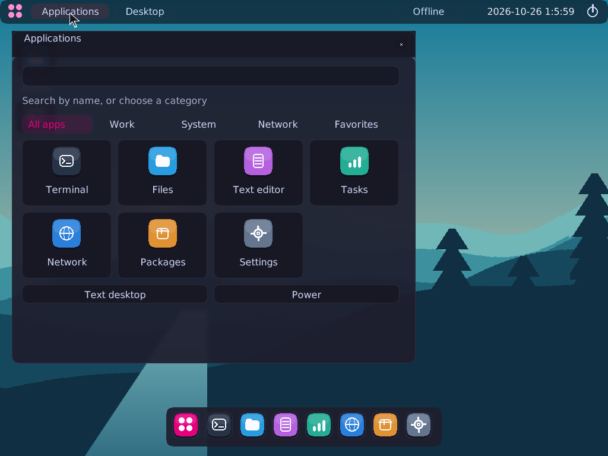
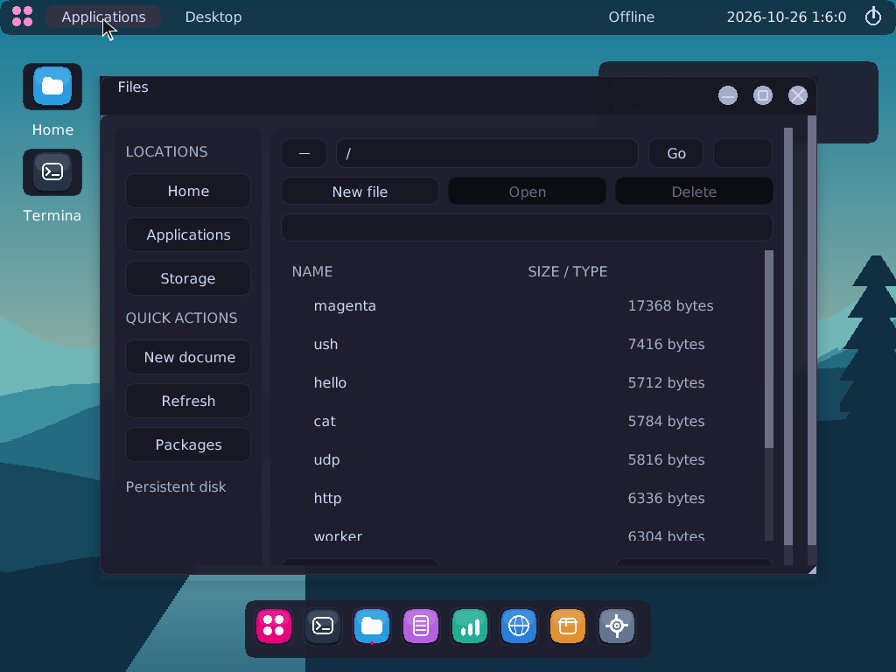
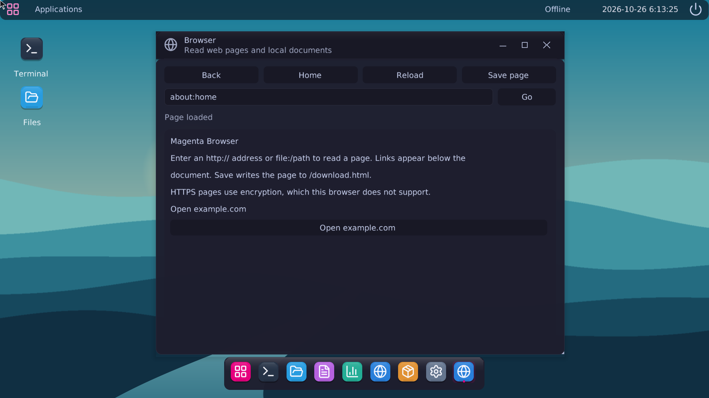
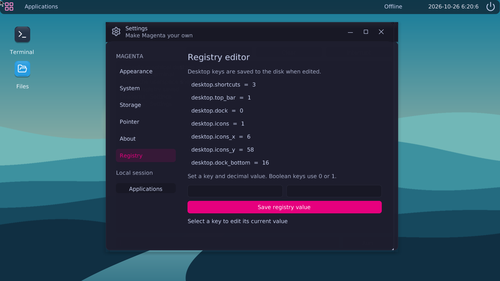

# Magenta
*This OS and kernel is not made for experimenting, learning, educational purpouses, and is not a hobby project. It is an indie OS designed to be run in both VMs and real hardware, though advanced hardware support is in the works!*
Magenta is an x86-64 operating system written in C and assembly, built on [Avalanche Kernel](avalanche/). It has a desktop, a shell, files and folders, networking, and a package manager.


## Download

Get [Magenta 0.2.0 — Mountains](https://github.com/Bobdahacker-official/poverty/releases/tag/magenta-v0.2.0). The release includes boot ISOs, writable disks, source, screenshots, and checksums.

- [Magenta ISO](https://github.com/Bobdahacker-official/poverty/releases/download/magenta-v0.2.0/magenta.iso)
- [Magenta data disk](https://github.com/Bobdahacker-official/poverty/releases/download/magenta-v0.2.0/magenta-data.img)
- [Avalanche ISO](https://github.com/Bobdahacker-official/poverty/releases/download/magenta-v0.2.0/avalanche.iso)

For the latest build, use the files in [Images](Images/). Releases mark version updates; ordinary commits don't create a release.

## Run it in VirtualBox

Create a 64-bit Other/Unknown VM with 256 MiB of RAM. Attach `magenta.iso` as an IDE optical drive and `magenta-data.img` as a hard disk. For networking, choose Intel PRO/1000 MT Desktop (`82540EM`) with NAT.

You can also create the VM with:

```sh
./copy.sh --virtualbox Magenta
VBoxManage startvm Magenta
```

Keep the VM's data disk when replacing the ISO. `./copy.sh /path/to/Magenta` copies the release files to a directory.

## Desktop

The dock opens Terminal, Files, Text editor, Tasks, Network, Packages, Settings, and Browser. The launcher has search and app categories. Windows move, resize, minimize, maximize, and close. Text, controls, and the dock scale with the boot framebuffer.



In Files, choose **New file** or **New folder** to create an item. Select an item to **Open**, **Rename**, or **Delete** it. Folder creation uses ext4; folders must be empty before deletion. The editor saves text files and asks before discarding changes.



Right-click an app in the launcher or dock to add a desktop shortcut. Right-click its desktop icon to remove the shortcut.

Settings changes the theme, accent, wallpaper, transparency, blur, and pointer speed. **Mountains** is the default wallpaper. Settings → Registry changes desktop shortcuts, bar visibility, and positions. You can edit the same values in Terminal:

```text
reg list
reg desktop.dock
reg desktop.dock 0
reg desktop.dock 1
```

`desktop.top_bar`, `desktop.dock`, and `desktop.icons` use `0` for hidden and `1` for visible. `desktop.icons_x`, `desktop.icons_y`, and `desktop.dock_bottom` set positions in pixels. `desktop.shortcuts` stores the shortcut bitmask. Changes are saved to disk.

Ctrl-T opens Terminal; Ctrl-F opens Files; Ctrl-E opens the editor. Ctrl-K, Ctrl-N, Ctrl-P, and Ctrl-O open Tasks, Network, Packages, and Settings. Ctrl-S saves a document. Ctrl-M maximizes or restores the active window. Escape opens the text interface after checking for unsaved edits.

## Browser and registry

Browser reads HTTP pages and local documents through Magenta's network and file APIs. Press Ctrl-B to open it and Ctrl-L to edit the address. It follows links, keeps a session history, reloads pages, and saves their source to `/download.html`. Addresses can include a port, such as `http://10.0.2.2:8080/`. Use `file:/path` to read a file. The browser displays document text and links; HTTPS, JavaScript, and CSS are outside its current format support.



Press Ctrl-G to open the Registry editor. In Settings → Registry, click a row to load its current value, change it, then save. The table reads the same values as `reg` commands in Terminal. A failed disk write is reported and leaves the previous value in place.



## Build

Install GCC, binutils, Make, Python 3, GRUB's BIOS and x86-64 EFI modules, xorriso, mtools, and e2fsprogs. The build also uses GCC's i386 support for the compatibility examples.

```sh
make -C magenta
make -C magenta package
make run
```

The build writes to `avalanche/build/`. Packaging copies the boot ISO and a fresh Avalanche data disk into `Images/`. `make run` creates and attaches a 9 GiB ext4 disk when needed. `make test` runs the host and QEMU checks. `make packages` builds the sample packages.

## Kernel

Avalanche runs native programs in x86-64 long mode. It has a 256-slot process table, priority scheduling, separate address spaces, copy-on-write fork, and demand paging. Its ext4 driver supports 4 KiB blocks, extents, 64-bit descriptors, sparse files, and journal replay. Storage drivers include ATA, AHCI, and transitional VirtIO; network drivers include RTL8139, E1000, and transitional VirtIO.

The package manager installs, removes, upgrades, lists, queries, and searches packages. It downloads packages over HTTP and keeps its database on ext4. The shell and native programs run in ring 3. The included `linuxhello` and `linuxfork` programs use the Linux i386 compatibility ABI.

See [kernel details](avalanche/images/NOTICE) and [distribution details](magenta/images/NOTICE) for more.

## Source and credits

`avalanche/` contains the kernel, drivers, programs, and build tools. `magenta/` contains the distribution configuration. `Images/` holds boot images, data disks, and screenshots. `index.html` is drawing Inc, a separate drawing game.

The desktop uses [Nuklear](https://github.com/Immediate-Mode-UI/Nuklear), [Catppuccin](https://github.com/catppuccin/palette), [Lucide](https://lucide.dev/), and DejaVu fonts. Its layout takes ideas from elementary, COSMIC, Linux Mint, and macOS.

Avalanche source uses the [MIT license](avalanche/LICENSE). GRUB, Nuklear, Catppuccin, Lucide, DejaVu, and v86 keep their own licenses. Their notices are included with the source and in the ISO's `/licenses` directory. GRUB source and Debian patches are in [grub-source](avalanche/images/grub-source/).
