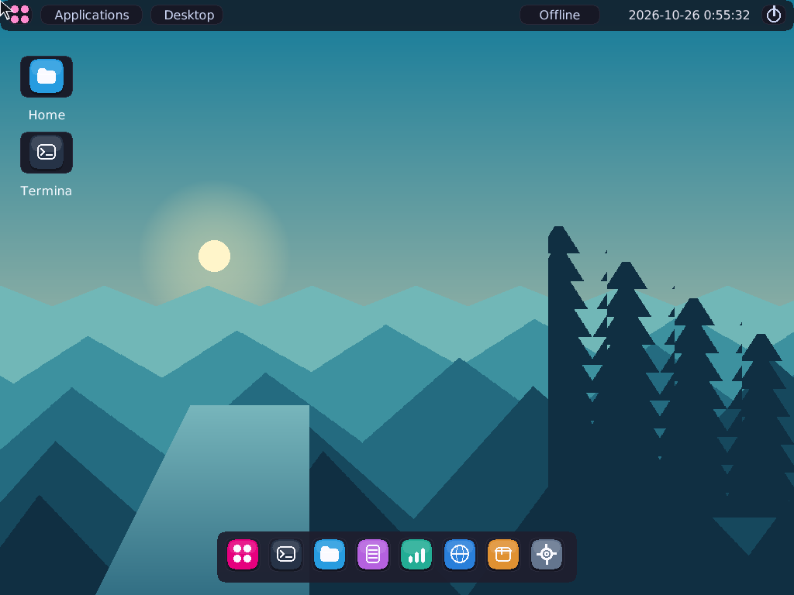

# Magenta
*This OS is not a hobby OS, it is not "niche", and it is not educational or a proof of concept or portfolio project! please do no call it that. this is in the first stage of production.* 

**Magenta 0.1** is a native x86-64 operating system distribution powered by [Avalanche Kernel](avalanche/). It includes a graphical desktop, a text interface, bundled applications, a BIOS/UEFI boot image, and persistent storage.

The graphical desktop uses [Nuklear](https://github.com/Immediate-Mode-UI/Nuklear), an open-source C UI toolkit, with [Catppuccin](https://github.com/catppuccin/palette) themes and a #E6007E magenta accent. It boots to a clean desktop with a teal mountain-and-lake landscape, a slim top panel, a translucent centered dock, colored application icons, and an antialiased outlined cursor. Settings opens on request. The searchable application grid takes layout inspiration from [elementary's Applications Menu](https://github.com/elementary/applications-menu), alongside the supplied Linux Mint and macOS references; Appearance retains the [COSMIC](https://github.com/pop-os/cosmic-epoch)-inspired sidebar and theme cards. The native compositor draws translucent rounded windows, blurred backgrounds, shadows, glossy highlights, opening animations, and notifications. Antialiased DejaVu Sans text is rendered directly from TrueType outlines.

Terminal, Files, Text editor, Tasks, Network, Packages, and Settings launch from the dock. Terminal runs the ring-3 shell; Files browses directories and launches executables; the editor saves documents and confirms unsaved changes. Tasks manages live processes and priorities, Network configures the adapter and runs diagnostics, and Packages installs, upgrades, removes, and downloads packages. Settings saves the palette, accent, wallpaper, transparency, blur, and pointer speed to the writable disk. Windows support dragging, resizing, minimizing, maximizing, and closing.

The launcher groups applications into All apps, Work, System, Network, and Favorites, with search across the selected category. Files has a locations sidebar and quick actions for creating documents, refreshing the current folder, opening storage settings, and managing packages. Colored window controls share the same touch targets, while the menu bar and dock use quieter backgrounds to keep attention on application content.



The glossy desktop uses antialiased [Lucide](https://lucide.dev/) icons, glass highlights, translucent surfaces, and colored window controls. The icon sources, native atlas, and ISC/Feather MIT notices are included in [assets/lucide](avalanche/assets/lucide/). Visual research includes [WhiteSur](https://github.com/vinceliuice/WhiteSur-gtk-theme) and [Papirus](https://github.com/PapirusDevelopmentTeam/papirus-icon-theme).

Three captures of the running desktop: [Glossy desktop](Images/glossy-desktop.png), [application launcher](Images/glossy-launcher.png), and [Files workspace](Images/glossy-files.png).

## Downloads

- [Download Magenta BIOS/UEFI ISO](https://github.com/Bobdahacker-official/poverty/raw/refs/heads/main/Images/magenta.iso) — boot media with a default Magenta entry and a separate rescue-console entry.
- [Download Magenta writable data disk](https://github.com/Bobdahacker-official/poverty/raw/refs/heads/main/Images/magenta-data.img) — bundled applications and the `welcome` file in an Avalanche filesystem.
- [Distribution notes](magenta/images/NOTICE) — architecture, features and licensing.

The ISO is read-only boot media. Attach the separate writable data disk for persistent files. Without a recognized disk, the interface uses RAM storage and identifies it as temporary.

## VirtualBox

Magenta's BIOS boot image and Intel E1000 network driver are configured for VirtualBox. Create a 64-bit Other/Unknown VM manually with 256 MiB of memory, attach `magenta.iso` as an IDE optical drive, attach `magenta-data.img` as a virtual hard disk, and select the Intel PRO/1000 MT Desktop (`82540EM`) network adapter with NAT.

The included [`copy.sh`](copy.sh) copies both release files to a directory:

```sh
./copy.sh /path/to/Magenta
```

It can also create and register a complete VirtualBox machine. This requires VirtualBox's `VBoxManage` command and converts a copy of the data image to VDI, keeping the packaged image unchanged:

```sh
./copy.sh --virtualbox Magenta
VBoxManage startvm Magenta
```

The data disk is where saved files live. Keep its generated `magenta-data.vdi` when upgrading the ISO; replacing it starts a fresh installation.

## Browser emulator (Copy.sh)

To boot Magenta through a browser, [open this repository in GitHub Codespaces](https://codespaces.new/Bobdahacker-official/poverty). The included configuration installs QEMU and noVNC, starts Magenta automatically, and opens the desktop on forwarded port **6080**. The virtual machine runs in the Codespace; the browser controls its display. Its writable disk is retained in `avalanche/build/browser-session/data.img` across restarts of that Codespace.

The launcher selects KVM when available and otherwise uses QEMU's software emulator. The desktop caches unchanged drawing commands and updates the cursor separately. noVNC uses lossless compressed updates, fits smaller screens, and keeps the desktop at its native size on larger screens. An absolute virtual pointer maps touch coordinates directly to the desktop; physical machines retain PS/2 input. Minimize, maximize/restore, and close controls share 36-pixel square hit areas. After pulling an update, run `bash tools/boot-browser.sh --restart` to boot the new image with the existing writable disk.

Tap **Keyboard** in the viewer to open your phone or tablet keyboard. Tap a text field in Magenta to type there; the viewer keeps the keyboard open. Its toolbar also provides Enter, Backspace, Tab, Esc, arrows, and toggleable Ctrl/Alt keys. **Hide keyboard** dismisses it. `bash tools/boot-browser.sh --restart-vnc` restarts only the browser viewer and keeps the OS and applications running; `--restart` restarts both the viewer and the VM.

Copy.sh's v86 emulator does not implement x86-64 long mode and cannot run these new 64-bit images. The [browser page](copy.sh.html) explains this limitation and links to the downloads. Use VirtualBox with a 64-bit VM type, or QEMU's `qemu-system-x86_64`. The old 32-bit images have been replaced; the repository does not present them as the 64-bit build.

## Interface

The default entry starts the graphical desktop when a suitable framebuffer is present. Escape opens the text interface after confirming unsaved changes. Ctrl-T, Ctrl-F, Ctrl-E, Ctrl-K, Ctrl-N, Ctrl-P, and Ctrl-O open Terminal, Files, Text editor, Tasks, Network, Packages, and Settings. Ctrl-S saves an editor document; Ctrl-M maximizes or restores the active window. In the text interface, choose a numbered option and press Enter:

```text
MAGENTA 0.1 | Home

1  Files       Read, create, edit and delete
2  Programs    Run applications
3  Processes   View and manage tasks
4  Network     Configure and connect
5  System      Devices, memory and uptime
6  Shell       Open a command prompt
0  Power       Restart, halt or rescue

Magenta>
```

| Screen | Implemented actions |
| --- | --- |
| Files | List files, read text or a bounded binary hex view, create text, replace or append text, delete with confirmation. |
| Programs | Launch bundled or disk-based ELF applications in the foreground or background and report foreground exit status. |
| Processes | Show task IDs and states, wait for child processes, terminate a selected task with confirmation. |
| Network | Show adapter/address information, request DHCP, apply static IPv4 settings, ping, resolve DNS, launch an HTTP client. |
| System | Show actual memory, storage and uptime information, list detected devices, read the firmware clock. |
| Shell | Open the userspace shell; `exit` returns to Magenta. |
| Power | Confirm restart, halt or exit to the rescue console. |

The text editor accepts ASCII text, up to 511 characters per entered line and 64 KiB per file. `.save` writes changes; `.cancel` discards them. The interface rejects binary files for editing; its reader shows a bounded hexadecimal view instead. Prefix a command with another dot to insert it literally, such as `..save`. Network configuration lasts for the session.

## Bundled applications

| Program | Purpose |
| --- | --- |
| `magenta` | The text-based distribution interface. |
| `ush` | Interactive shell; type `help` for its commands. |
| `hello` | Display arguments and uptime ticks. |
| `cat` | Read a file supplied as an argument. |
| `udp` | Send a message to an IPv4 address and UDP port. |
| `http` | Fetch an HTTP resource on port 80. |
| `worker` | CPU-bound background application. |
| `linuxhello` | Exercise the supported Linux i386 file, memory and TLS APIs. |
| `linuxfork` | Demonstrate Linux-style fork, wait and private process memory. |

The data disk also contains a `welcome` text file. Foreground programs return to Magenta when they exit. Background jobs can be viewed in Processes; wait for completed children to reclaim their process slots.

## Implementation and builds

[Magenta's text interface](avalanche/user/magenta.c) runs in ring 3. Hardware access, storage, process isolation, networking, and framebuffer composition run in the kernel. The default boot entry passes `--magenta`; the kernel starts the graphical desktop when a framebuffer is available and enters the text interface after it closes. The Magenta executable is also embedded as a fallback when no data disk is attached.

Build the distribution:

```sh
make -C magenta
```

Outputs are `avalanche/build/magenta.iso` and `avalanche/build/magenta-data.img`. Ordinary builds retain an existing writable data image, including any files already saved in it.

When upgrading a data disk from the old 32-bit release, boot the rescue-console entry and run `install` to replace the bundled applications with the new native binaries while preserving other files. Alternatively, use the freshly packaged release data disk. A stored old 32-bit `magenta` executable cannot run as the native 64-bit interface.

Package fresh distribution artifacts:

```sh
make -C magenta package
```

This replaces the Magenta release images in `Images/` and creates a fresh release data disk from the bundled applications and welcome file. It does not refresh applications inside an existing working data disk.

Build prerequisites are GCC/binutils with freestanding x86-64 and i386 compatibility-application support, GNU Make, Python 3, GRUB BIOS and x86-64 EFI modules, xorriso and mtools. `GRUB_LIB` can select an alternative GRUB module directory.

## Scope

Avalanche has a 256-slot process table, preemptive priority scheduling with aging and time slices, copy-on-write fork pages, anonymous demand paging, and a static Linux i386 compatibility ABI. Supported storage includes legacy ATA, AHCI and legacy/transitional VirtIO; network drivers include RTL8139, E1000 and legacy/transitional VirtIO. Its ext4 driver reads and writes 4 KiB filesystems, creates files, grows sparse files beyond 4 GiB, replaces and removes files, and uses JBD2 transactions with committed-transaction replay. A writeback cache serves the block drivers. An attached ext4 disk becomes the root filesystem; Avalanche FS and RAM storage provide fallback options.

The kernel and native applications execute in x86-64 long mode. Four-level paging uses supervisor identity mappings and private 4 KiB user mappings. The allocator manages RAM below 128 MiB, and service addresses are bounded below 4 GiB. The UEFI loader targets x86-64 firmware.

`make run` creates and attaches a persistent 9 GiB ext4 disk when its working disk is absent. `make test` runs host filesystem checks and headless QEMU checks, including journal recovery, large files, process isolation, package downloads, and graphical screen and editor checks. `make packages` builds five HTTP-ready sample packages with versioned manifests, dependency lists, and SHA-256 hashes. The package manager supports `pkg install`, `remove`, `upgrade`, `list`, `query`, `search`, and `fetch HOST /MANIFEST`; its package files and database use the attached ext4 root.

See [Avalanche's capability notes](avalanche/images/NOTICE) for the kernel's architecture and implemented services.

## Repository

- `Images/` — Magenta and Avalanche boot images, writable data disks, and desktop screenshot.
- `magenta/` — distribution boot configuration, welcome file, build entry point and distribution notices.
- `avalanche/` — kernel, hardware drivers, userspace applications and build tools.
- `index.html` — drawing Inc, the separate browser drawing game.

Source is covered by [Avalanche's MIT license](avalanche/LICENSE). Bundled GRUB retains its [own licensing](avalanche/images/GRUB-COPYRIGHT), with corresponding source included in [grub-source](avalanche/images/grub-source/). The included Copy.sh v86 runtime and BIOS files retain their [BSD-2-Clause license](emulator/v86/LICENSE).

Nuklear and its bundled Catppuccin themes retain their [MIT license](avalanche/vendor/nuklear/LICENSE), alongside the [Catppuccin MIT license](avalanche/vendor/nuklear/CATPPUCCIN-LICENSE). Exact upstream revisions and file origins are recorded in [ORIGIN.md](avalanche/vendor/nuklear/ORIGIN.md). The bundled DejaVu fonts retain their [font license](avalanche/assets/FONT-LICENSE). The ISO includes these notices in `/licenses`.

## Desktop shortcuts, folders, and registry

In Files, use **New file** or **New folder** to create an item in the current folder. Select an item to **Open**, **Rename**, or **Delete** it. Folders open in Files; deletion requires an empty folder. The browser desktop keeps its writable ext4 disk at `avalanche/build/browser-session/ext4.img` across restarts.

Right-click an app in the launcher or dock and choose **Add shortcut**. Right-click a desktop icon to choose **Remove shortcut**. Settings → Registry edits persistent desktop keys. The Terminal accepts `reg list`, `reg desktop.dock`, and `reg desktop.dock 0` to list, read, and change keys. `desktop.top_bar`, `desktop.dock`, and `desktop.icons` take 0 or 1; `desktop.icons_x`, `desktop.icons_y`, and `desktop.dock_bottom` set positions in pixels; `desktop.shortcuts` stores the shortcut bitmask.
