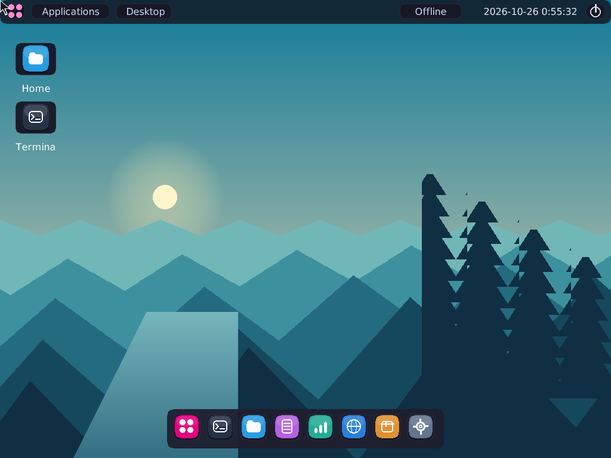
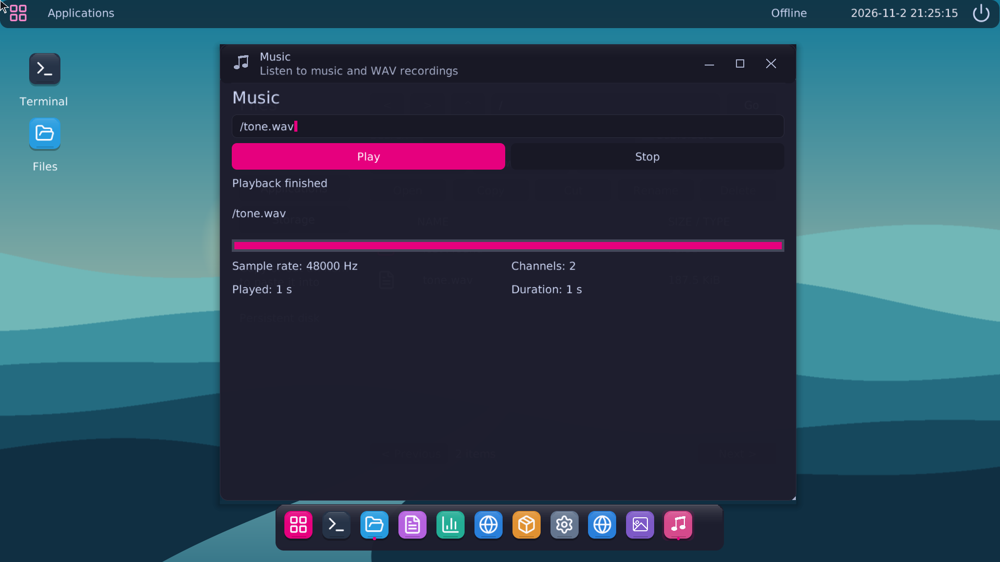
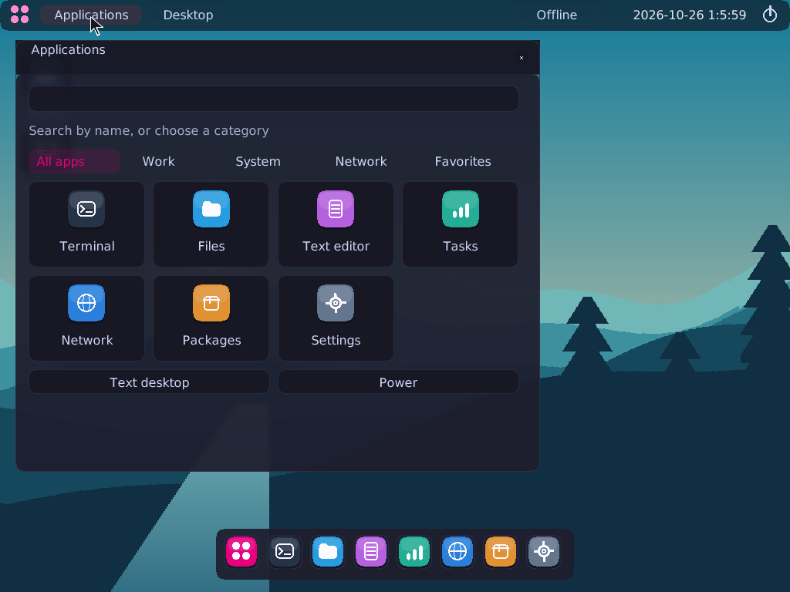
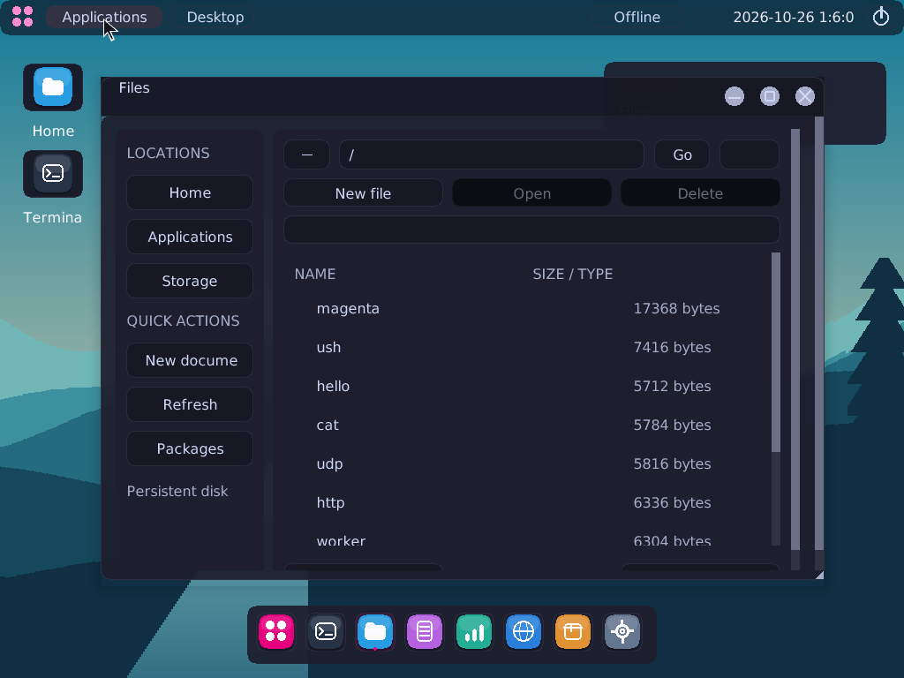
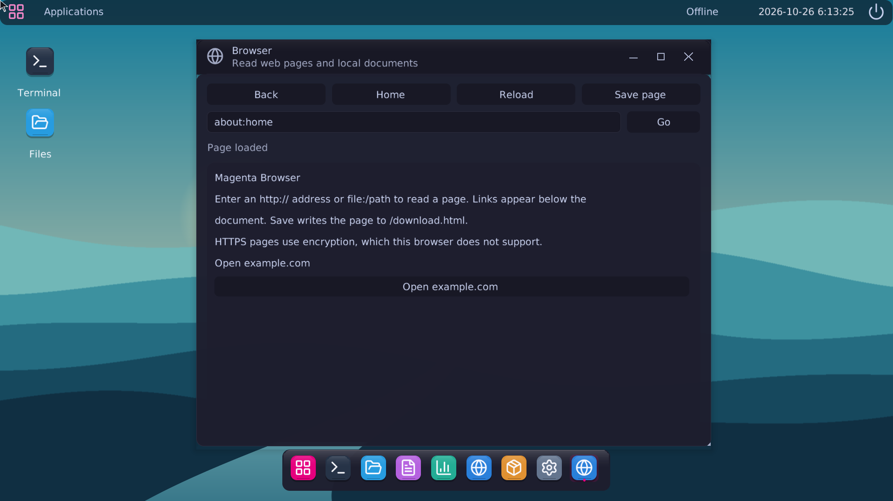
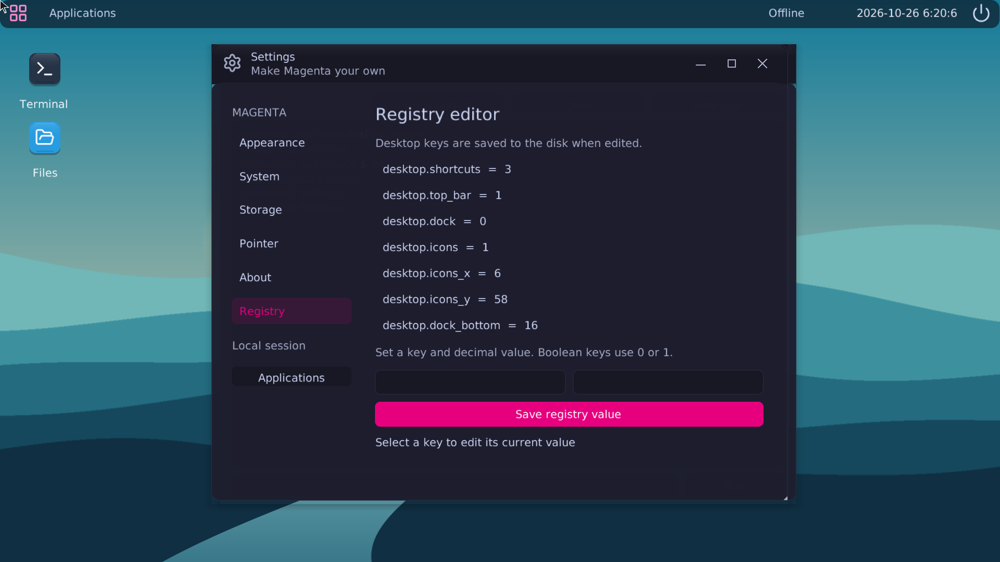

# Magenta
*This OS and kernel is not made for experimenting, learning, educational purpouses, and is not a hobby project. It is an indie OS designed to be run in both VMs and real hardware, though advanced hardware support is in the works!*
Magenta is an x86-64 operating system written in C and assembly, built on [Avalanche Kernel](avalanche/). It has a desktop, a shell, files and folders, networking, and a package manager.



## Download

Get [Magenta 0.2.0 — Mountains](https://github.com/Bobdahacker-official/poverty/releases/tag/magenta-v0.2.0). The release includes boot ISOs, writable disks, source, and checksums.

- [Magenta ISO](https://github.com/Bobdahacker-official/poverty/releases/download/magenta-v0.2.0/magenta.iso)
- [Magenta data disk](https://github.com/Bobdahacker-official/poverty/releases/download/magenta-v0.2.0/magenta-data.img)
- [Avalanche ISO](https://github.com/Bobdahacker-official/poverty/releases/download/magenta-v0.2.0/avalanche.iso)

For the latest build, use the files in [Images](Images/). Releases mark version updates; ordinary commits don't create a release.

## Run it in VirtualBox

Create a 64-bit Other/Unknown VM with 256 MiB of RAM. Attach `magenta.iso` as an IDE optical drive and `magenta-data.img` as a hard disk. For networking, choose Intel PRO/1000 MT Desktop (`82540EM`) with NAT.

You can also create the VM with:

```sh
./copy.sh --virtualbox Magenta
VBoxManage startvm Magenta
```

Keep the VM's data disk when replacing the ISO. `./copy.sh /path/to/Magenta` copies the release files to a directory.

## Desktop

The dock opens Terminal, Files, Text editor, Tasks, Network, Packages, Settings, Browser, Images, and Music. The launcher has search and app categories. Windows move, resize, minimize, maximize, and close. Text, controls, and the dock scale with the boot framebuffer.

Images opens PNG, JPEG, and BMP pictures from Files or a typed path. Ctrl-U opens the viewer. Images retain their aspect ratio and fit the available window space. The decoder uses runtime-sized memory buffers, accepts files up to 16 MiB, and keeps the current picture open if another file fails to decode. Ext4 reads can span larger files through the offset-based file API.

Music opens PCM16 WAV files from Files or a typed path. Ctrl-D opens the player. Play and Stop control the HDA stream; progress, duration, sample rate, and channel count come from the running playback state. Other windows and processes keep running during playback. `run aplay /PATH.wav` plays a file from the console, and `aplay /PATH.wav` works in Terminal. Native programs have `av_audio_play`, `av_audio_status`, and `av_audio_stop` SDK calls.





Right-click the desktop for file creation, Files, Terminal, appearance settings, desktop icon visibility, System Monitor, and refresh. New files and folders are created in Home through Files. Right-click an app icon to manage its desktop shortcut.

Files has back/forward navigation, a location field, name search with an optional Subfolders search, folder icons, readable sizes, and selected-item details. Double-click an item or select it and press Enter to open it. Copy, cut, and paste work for files and folders; ext4 file copies stream in blocks and are not limited to the editor's 64 KiB document size. Moving an ext4 folder updates its parent in one filesystem transaction. Pasting a copy beside an existing item chooses an unused `-copy-N` name; moving never overwrites an existing item. Right-click the list for file actions. Use Ctrl+L for the location, Ctrl+F for search, Ctrl+C/X/V for file operations when not editing text, F2 to rename, and Delete to request deletion. Search scans up to 32,768 entries and 16 nested levels and reports when that limit is reached.

Folder creation uses ext4; folders must be empty before deletion. The editor saves text files and asks before discarding changes.



Right-click an app in the launcher or dock to add a desktop shortcut. Right-click its desktop icon to remove the shortcut.

Settings changes the theme, accent, wallpaper, transparency, blur, and pointer speed. **Mountains** is the default wallpaper. Settings → Registry changes desktop shortcuts, bar visibility, and positions. You can edit the same values in Terminal:

```text
reg list
reg desktop.dock
reg desktop.dock 0
reg desktop.dock 1
```

`desktop.top_bar`, `desktop.dock`, and `desktop.icons` use `0` for hidden and `1` for visible. `desktop.icons_x`, `desktop.icons_y`, and `desktop.dock_bottom` set positions in pixels. `desktop.shortcuts` stores the shortcut bitmask. Changes are saved to disk.

Ctrl-T opens Terminal; Ctrl-F opens Files; Ctrl-E opens the editor. Ctrl-K, Ctrl-N, Ctrl-P, and Ctrl-O open System Monitor, Network, Packages, and Settings. Inside Files, Ctrl-F focuses search. Inside Browser, Ctrl-T opens a tab. Ctrl-S saves a document. Ctrl-M maximizes or restores the active window. Escape dismisses menus and pending file actions before returning to the text interface after checking for unsaved edits.

System Monitor has live process and performance views, per-process CPU samples, memory usage, a name/PID filter, pause/resume, priority controls, and process termination. Its kernel entry represents the built-in desktop apps, which share the kernel rather than appearing as separate userspace processes. The CPU graph measures actual userspace timer ticks; the remaining CPU time includes both kernel work and idle time. History keeps the last 60 samples.

## Browser and registry

Browser reads HTTPS and HTTP pages and local documents through Magenta's network and file APIs. Press Ctrl-B to open it and Ctrl-L to edit the address. It follows links, keeps a session history, reloads pages, and saves their source to `/download.html`. Addresses can include a port, such as `http://10.0.2.2:8080/`. Use `file:/path` to read a file. It checks TLS certificates and runs embedded JavaScript through Elk. It renders basic CSS colors, type sizes, spacing, classes, IDs, and inline styles, and loads linked CSS and scripts. Its HTML and CSS coverage is still small.

Browser supports up to eight tabs. Each tab retains an independent DOM, JavaScript heap, page source, back/forward history, and scroll position. Use + or Ctrl+T to open a tab, x or Ctrl+W to close it, and Ctrl+Tab / Ctrl+Shift+Tab to switch tabs. The last tab closes to a fresh start page. Reload and Save Page apply to the active tab. The address field accepts bare host names using HTTPS by default.



Press Ctrl-G to open the Registry editor. In Settings → Registry, click a row to load its current value, change it, then save. The table reads the same values as `reg` commands in Terminal. A failed disk write is reported and leaves the previous value in place.



## Build

Install GCC, binutils, Make, Python 3, GRUB's BIOS and x86-64 EFI modules, xorriso, mtools, and e2fsprogs. The build also uses GCC's i386 support for the compatibility examples.

```sh
make -C magenta
make -C magenta package
make run
```

The build writes to `avalanche/build/`. `make package` copies both boot ISOs and fresh data disks into `Images/`, then updates their SHA-256 checksums. `make run` creates and attaches a 9 GiB ext4 disk when needed. `make test` runs the host and QEMU checks. `make packages` builds the sample packages.

The UEFI tests use OVMF firmware. Install `ovmf`, or set `OVMF_DIR` to a directory containing `OVMF_CODE_4M.fd` and `OVMF_VARS_4M.fd`.

## Desktop PC hardware

The hardware checks include a UEFI desktop with 32 GiB of RAM and a 1 TB NVMe disk, using both 512-byte and 4 KiB native sectors. Ext4 partitions are found on GPT disks and primary Linux MBR partitions. GPT header and table checksums are verified, backup GPT headers are supported, and overlapping partitions are rejected. Filesystem reads, journal replay, and writes stay within the partition's bounds. Windows data partitions are left alone.

GeForce RTX 4060-class cards use the UEFI GOP framebuffer supplied by the card's firmware. GRUB selects an available graphics mode and passes it to the kernel. Magenta renders the desktop on the CPU; this path provides display output without NVIDIA 3D or CUDA acceleration. Boot the ISO in UEFI mode with Secure Boot disabled. `display` reports the boot firmware, framebuffer dimensions and pixel layout, renderer, and actual PCI display-adapter IDs.

## Kernel

Avalanche runs native programs in x86-64 long mode. It has a 256-slot process table, priority scheduling, separate address spaces, copy-on-write fork, and demand paging. Its ext4 driver supports 4 KiB blocks, extents, 64-bit descriptors, sparse files, and journal replay. Storage drivers include ATA, AHCI, NVMe, USB mass storage, and transitional VirtIO; network drivers include AMD PCnet, RTL8139, E1000, and transitional VirtIO. USB 1.1 UHCI controllers handle boot-protocol keyboards and mice, including devices behind a hub. PCI devices are discovered through ACPI MCFG on PCI Express machines and configuration ports on older systems. The device inventory holds up to 1,024 PCI functions and 64 disks.

USB disks connected at boot use SCSI commands over Bulk-Only Transport on UHCI or xHCI controllers. xHCI handles USB 2 and USB 3 devices, command and transfer rings, controller ownership, root-port reset, endpoint configuration, hubs, and interrupt HID reports. Keyboards, mice, and storage can share a controller. The storage driver reads, writes, and flushes disks with 512-byte, 1 KiB, 2 KiB, or 4 KiB logical sectors. Writes to part of a larger sector preserve the other bytes. USB disks use the same block cache and ext4 filesystem as internal drives. Malformed command-status replies trigger transport reset and endpoint recovery. The checks cover directly attached disks, hubs with disks and keyboards, producer-ring wraparound, and disks with 4 KiB sectors.

Keyboard and mouse reports continue to be processed during bulk disk transfers. A separate check disables PS/2 and types commands through a USB keyboard while writes are in progress on a disk attached to the same hub.

Intel HD Audio supplies analogue PCM playback. Codec discovery follows pin, selector, mixer, and DAC connections; it configures power, amplifiers, stream format, and the output stream. A DMA ring buffers playback while polling refills it from storage. Mono and stereo PCM16 WAV playback supports 8, 16, 22.05, 24, 32, 44.1, 48, and 96 kHz when the codec accepts the rate. Tests capture the emulated audio output and check the actual stereo samples, including playback from a ring-3 app and a responsive Music window.

The kernel maps physical addresses through 64 GiB. Allocated pages use a separate, supervisor-only memory mapping, so RAM above 4 GiB stays accessible while applications run. Native programs have a 64 MiB address window and up to 64 MiB of mapped pages, with 64 KiB reserved for the stack. Disk-backed ELF files can be up to 32 MiB. `mem` reports managed RAM, free pages, and allocations above 4 GiB. The memory checks boot with 256 MiB, 8 GiB, and 32 GiB and run an ext4 executable with 16 MiB of writable data.

Device registers use sparse mappings beyond the RAM window, bounded by the CPU's physical address width. E1000 and NVMe accept 64-bit PCI memory BARs. NVMe doorbell addresses follow the controller's advertised stride. The hardware checks cover ATA, AHCI, VirtIO block, and NVMe storage with PCnet, RTL8139, VirtIO net, and E1000 networking on the PC and Q35 chipsets.

The package manager installs, removes, upgrades, lists, queries, and searches packages. Downloads default to HTTPS and verify manifest signatures against a locally pinned RSA certificate, then check the executable's SHA-256. Explicit `http://` repositories also require signatures. `pkg trust LOCAL-DER-CERTIFICATE` saves the signing certificate and prints its fingerprint. `pkg fetch HOST /MANIFEST` verifies the manifest's `.sig` companion before installing anything.

Updates and removals save an on-disk recovery record plus the previous executable and package record. Startup restores an interrupted transaction; corrupt backups block package changes rather than overwriting the live package. Version checks reject downgrades. The repository builder accepts `--signing-key` and `--certificate`; private keys stay outside the repository and distribution images.

On CPUs with NX support, user stacks and data pages are non-executable. ELF execute flags determine code-page permissions; Linux compatibility mappings apply their requested execute permissions. Copy-on-write and demand paging retain these protections. CPUs without NX use the existing paging path.

Hardware randomness comes from CPU RDRAND or a transitional VirtIO RNG device. TLS uses that source for session entropy, and native programs can request random bytes through `av_random`. If neither source is available, the random API reports an error and TLS refuses the connection. Linux process startup supplies `AT_RANDOM` only when hardware entropy is available.

The shell and native programs run in ring 3. The included `linuxhello` and `linuxfork` programs use the Linux i386 compatibility ABI.

See [kernel details](avalanche/images/NOTICE) and [distribution details](magenta/images/NOTICE) for more.

## Source and credits

`avalanche/` contains the kernel, drivers, programs, and build tools. `magenta/` contains the distribution configuration. `Images/` holds boot images, data disks, and screenshots. `index.html` is drawing Inc, a separate drawing game.

The desktop uses [Nuklear](https://github.com/Immediate-Mode-UI/Nuklear), [Catppuccin](https://github.com/catppuccin/palette), [Lucide](https://lucide.dev/), and DejaVu fonts. Its layout takes ideas from elementary, COSMIC, Linux Mint, and macOS.

Avalanche source uses the [MIT license](avalanche/LICENSE). The linked Elk engine is licensed under [AGPL-3.0](avalanche/vendor/elk/AGPL-3.0.txt); its source is included in this repository. BearSSL, printf, and the stb image decoder carry their own MIT licenses. GRUB, Nuklear, Catppuccin, Lucide, DejaVu, and v86 keep their own licenses. Their notices are included with the source and in the ISO's `/licenses` directory. GRUB source and Debian patches are in [grub-source](avalanche/images/grub-source/).
